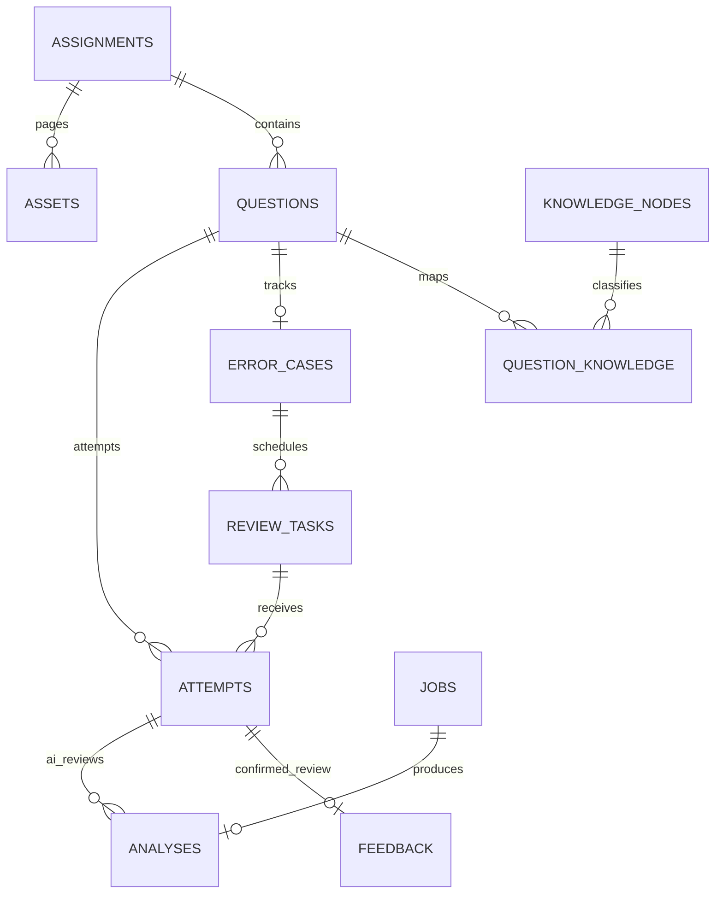
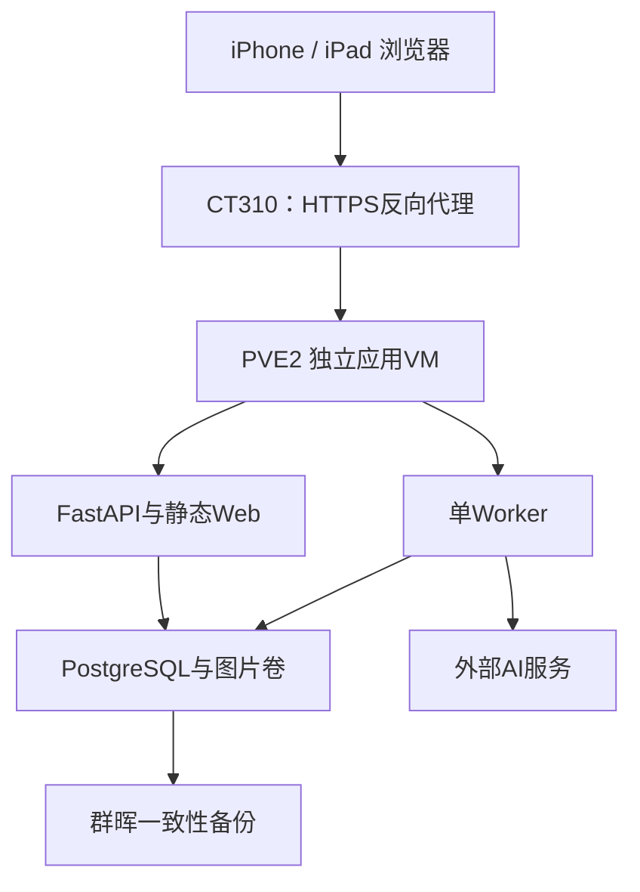

# 学迹：家庭高中学习档案 一期设计与开发基线

版本：v0.1.0 ｜日期：2026-11-08 ｜部署时区：Asia/Shanghai

## 1. 一期目标与边界

围绕数学、英语、语文学校作业，完成以下业务闭环：

**归档原图 → 确认题目和作答 → AI初审 → 确认错因 → 记录订正与反馈 → 查询报表 → 原题回顾 → 同类题验证。**

当前开发基线是单家庭、共享管理身份的应用；它不是多租户SaaS。设计保留未来家庭空间、成员和学生身份分离的迁移方向，但当前数据库没有实现租户隔离，不得直接把多个无关家庭放入同一个实例。

不在一期核心范围：LoRA、通用聊天、完整高中题库采购、复杂知识图谱、实时语音、精细发音评分、自动判断学生情绪、无人审核生成题正式入库。英语词表、作文专用编辑器可在共同档案基础上增加；本阶段作文可作为长文本题目初审，尚未实现上海作文评分细则。

用户提供的科目范围已固定为数学、英语、语文。第一版默认学生使用昵称，不内置真实姓名与学校信息。

## 2. 设计原则与状态

### 2.1 数据与判断分离

原图不覆盖；题干与原答案分离；每次作答追加保存。AI分析、人工反馈、参考答案来源分别保存。AI输出不会自动确认错题、提升掌握状态或修改学生原文。错因是候选，人工确认后的错因才进入报表。

同一道题的知识点、具体作答的错误原因、学生长期掌握情况是三个不同对象。当前错题状态只表示完成了哪些动作，不代表经过统计证明的知识掌握率。

### 2.2 错题生命周期

| 事件 | 前提 | 结果 |
|---|---|---|
| 人工确认初稿错误/部分正确 | 必须有具体错因 | needs_correction 待订正 |
| 保存新的订正作答 | 已有错题记录 | 保持状态，等待确认 |
| 人工确认订正正确 | 订正purpose=correction | corrected 已订正，允许带提示 |
| 原题复测确认正确 | 关联有效任务，assistance=none | recall_passed |
| 同类题验证确认正确 | 题目已审核且关联原题，独立完成 | transfer_passed |
| 复测错误/部分正确 | 人工确认 | needs_correction，重新整理 |
| 看过答案或提示后答对 | assistance不为none | 记录正确，但复测not_passed |
| 无法确定 | verdict=uncertain | 不提升状态，复测uncertain |

排期单独存在ReviewTask，避免以“待复习”覆盖已经完成的订正事实。当前没有时间间隔自动检查；管理员决定日期，报表不能据此自动宣称长期记忆稳定。旧初稿迟到的“正确”反馈不会清除已有错题。

### 2.3 任务生命周期

queued → running → succeeded / failed。任务在数据库持久化。Worker通过条件更新认领；默认一个Worker。模型调用最长90秒，超过5分钟未完成的任务租约标失败，要求人工重试。失败不修改学习状态。

同一Idempotency-Key、同一操作与内容返回同一任务；复用键但内容不同返回409。新键代表一次明确的新调用，可能再次计费。不能保证外部服务调用exactly-once，故不自动重试付费请求。

## 3. Web设计

### 3.1 页面结构

桌面侧栏、iPad宽屏双列、手机单列；按钮最小高度44px。颜色以深青、浅灰和白色为主，状态使用文字标签，不仅依赖颜色。所有用户内容作为文本转义，避免模型输出HTML被执行。

| 页面 | 主内容 | 关键动作 |
|---|---|---|
| 学习概览 | 作业数、确认错题数、到期回顾 | 新建作业、进入回顾 |
| 作业归档 | 按名称查询、科目、日期、学生 | 新建、上传多页照片 |
| 作业详情 | 原始页面与题目列表 | 查看原图、AI转录、手工录题 |
| 题目档案 | 题干、参考来源、作答时间线 | 保存初稿/订正、AI初审、确认反馈 |
| 错题分析 | 错因、状态、来源作业 | 查看订正、安排原题、生成变式 |
| 回顾与验证 | 日期、类型、处理状态 | 无答案提示的作答界面 |
| 查询报表 | 日期、科目、初稿分子分母、错因分布 | 查询、导出JSON |

### 3.2 图片与录入

现实现JPEG/PNG/WebP，单张≤12MiB、≤24MP，按文件字节实际解析而非只相信扩展名；同作业相同SHA256避免重复。按显式页码排序，不支持重排与删页，正式试用前补充。原始文件保留随机存储键，文件访问必须认证。

当前Safari HEIC不支持，需转JPEG；PDF、多页自动拆题、框选区域、公式可视化编辑器属于后续任务。AI转录只产生草稿，不自动当成确认题干。当前用户从草稿复制并校对后录入，少量重复操作是待优化项。

数学公式可保存Unicode/LaTeX文本；当前基础前端不渲染LaTeX，几何图通过关联原图查看。复杂图题在文本初审时不会自动送图，需要先图像转录或人工补充条件；独立图形理解需后续增加图像上下文适配。

### 3.3 反馈交互

反馈默认“无法确定”，避免误点即确认正确。错误/部分正确必须填写错因。AI意见单独显示供应商、模型、结论与原文引用；mock标志始终明确。

每次反馈不可原位覆盖。若录入或反馈有误，当前基线通过新作答再评价保留轨迹；正式试用前需补充“撤销反馈并重放状态”的管理接口。当前reviewer为填写的确认人名称，不是强身份审计。

复测界面不主动展示答案，但共享管理员账号仍可从题目详情/API查看答案。正式学生端必须补角色权限并从响应中移除答案，不能把当前UI隐藏视为访问控制。

## 4. 数据库设计

### 4.1 逻辑关系



### 4.2 表与约束

| 表 | 关键字段 | 约束/用途 |
|---|---|---|
| assignments | id,title,subject,student,assigned_date | 单次作业，student当前是昵称，后续迁移student_id |
| assets | assignment_id,page,storage_key,sha256,mime,size | 作业内页码唯一；存储键不使用上传文件名 |
| questions | assignment_id,asset_id,number,stem,reference,reference_source,source_question_id,approved | 原题/变式关联；未审核不能作答 |
| attempts | question_id,purpose,answer,explanation,assistance,review_id | 追加版本；purpose和assistance由API枚举校验 |
| jobs | kind,target_id,request_key,payload,status,result,error,timestamps | 请求键唯一；payload为不可变调用快照 |
| analyses | attempt_id,job_id,provider,model,prompt_version,result,usage | 每个任务最多一份分析；存Token用量，不伪造人民币费用 |
| feedback | attempt_id,analysis_id,verdict,reason,note,reviewer | 每次作答最多一份确认反馈；不覆盖历史 |
| error_cases | question_id,state,reason,updated_at,version | 一题一档；ORM乐观并发控制 |
| review_tasks | case_id,question_id,kind,due_at,status | 同类题必须审核且关联原题；未完成重复任务API拒绝 |
| knowledge_nodes | code,subject,label,kind,source | 稳定编号；目前仅表结构，未内置官方知识目录 |
| question_knowledge | question_id,node_id,relation | 复合主键；题目考查与学生错因分离 |

所有业务主键UUID字符串，created_at为UTC；作业日期是上海本地日期，due_at要求包含时区。PostgreSQL用timestamptz，SQLite只用于开发测试。枚举范围当前由Pydantic/API执行；禁止绕过API直接写入业务表。

PostgreSQL DDL见db/001_initial.sql，由ORM自动导出；初始表约束包含外键、唯一索引和检索索引。create_all只建空库，不能升级已有结构。下一次数据库结构变更前加入Alembic和升级/回滚测试。

## 5. AI与外部接口

### 5.1 内部能力接口

| 能力 | 输入 | 输出 | 当前实现 |
|---|---|---|---|
| extract | 图片、页码 | text, uncertain_regions | OpenAI兼容多模态输入；需显式启用 |
| grade | 题目、答案来源、作答、说明、辅助等级 | verdict,summary,issues,next_question | JSON字段验证＋引用片段检查 |
| variant | 原题、参考答案、确认错因 | stem,reference,rationale | 保存为未审核候选 |
| transcribe | 录音、语言 | 转写与时间戳 | 本期未实现，预留后续服务 |

grade固定输出示例：

```json
{
  "verdict": "partial",
  "summary": "已经列出条件，但遗漏参数为零的情况。",
  "issues": [{
    "quote": "两边同时除以a",
    "reason": "尚未说明a非零。",
    "suggestion": "分别讨论a=0和a不等于0。"
  }],
  "next_question": "当a=0时，原式是否仍成立？"
}
```

quote必须确实出现在学生answer中；不存在则整次任务失败，不伪造证据。合法JSON不代表结论可靠；保留人工确认。生成题必须人审，不直接提升掌握度。提示词标记上传内容为数据而非指令，模型无数据库写权限、无任意工具执行权限。

### 5.2 浏览器与后端REST接口

统一前缀/api/v1，Bearer共享家庭令牌。完整字段、枚举、必填项、参数及默认值以docs/openapi.json为准；运行时/docs可查看开发接口说明。

| 方法与路径 | 作用 |
|---|---|
| GET /config | 显示演示/真实模式，不返回密钥 |
| POST /assignments | 新建作业 |
| GET /assignments | q/subject/student/limit/offset查询 |
| GET /assignments/{id} | 页面与题目列表 |
| POST /assignments/{id}/assets?page=1 | multipart上传图片 |
| GET /assets/{id}/content | 认证后读取原图 |
| POST /assets/{id}/extraction-jobs | 图像转录任务，202 |
| POST /assignments/{id}/questions | 保存已核对题目 |
| GET /questions/{id} | 题目、作答、分析、反馈时间线 |
| POST /questions/{id}/attempts | 新增初稿、订正或复测作答 |
| POST /attempts/{id}/analysis-jobs | 提交AI初审，202 |
| GET /jobs/{id} | 轮询queued/running/succeeded/failed |
| POST /attempts/{id}/feedback | 人工确认并事务性更新错题状态 |
| GET /errors | subject/state/q/limit/offset查询 |
| POST /errors/{id}/reviews | 安排原题回顾或同类验证 |
| GET /reviews | due_only/limit查询 |
| POST /questions/{id}/variant-jobs | 生成同类题候选，202 |
| POST /questions/{id}/approve | 人工批准候选题 |
| GET /reports/summary | start/end/subject/student报表 |
| GET /export | 完整JSON导出，不含图片字节 |
| GET /healthz | 无认证存活检查，不代表数据库或AI就绪 |

所有创建AI任务的请求必须有Idempotency-Key（8至100字符）。当前其他创建请求没有客户端幂等键，保存失败后先查询再重试，后续统一扩展客户端operation_id。任务不支持取消；进程死亡遗留running任务5分钟后标失败。接口错误：401认证，404不存在，409冲突，413图片过大，415图片格式，422输入或关联不合法。

当前JSON输入限制主要为字段长度；公开部署前由反向代理限制总请求体、速率和并发，应用补全每日AI预算。目前没有费用硬上限，切真实模式后建议同时设供应商账户限额。

### 5.3 数据出站边界

AI密钥仅后端环境变量持有。文本初审不发送姓名昵称，但学生自己写入答案的个人信息不会自动清除；图像转录发送所选整图。无后台全库上传、无自动用作训练；调用记录保存模型名、提示词版本和Token用量。可按供应商条款及适用用户群选择服务，不默认某个提供商适用于未成年人。

## 6. 查询报表口径

当前按作业日期选取一组作业，再统计其关联记录，不是按反馈发生日期的活动统计。

- 已归档作业数：该范围内作业记录数。
- 题目数：范围内approved题目，包括审核通过的变式。
- 确认错题数：有人工确认的ErrorCase；AI候选不计。
- 独立初稿正确数/分母：purpose=original、assistance=none且人工反馈不是uncertain的作答次数；correct计分子，partial/incorrect计分母。允许多个original版本，故不是去重题目正确率。
- 辅助作答数：assistance不为none的所有作答。
- 错因分布：每个ErrorCase最新确认reason的分布；不是历次错误总次数。
- 原题/变式通过：必须对应任务、独立作答、人工确认正确。

不能从这些计数推导学校排名、考试分数、正式掌握率或因果教学效果。不同难度作业不可直接比较。未来增加相同题型、相近难度、延迟复测的分层趋势。

## 7. 基础设施要求

### 7.1 家庭拓扑



PVE2当前24GB内存，其他基础设施已常驻，应先核实空余。建议一期VM起步2vCPU/4GB RAM/40GB系统盘＋单独附件空间；这不是实测容量承诺。API推理不需GPU。若增加本地OCR/ASR，再给Worker独立4–8GB内存预算并测试；PVE0/PVE1可按需承担批量任务。不要因为预留SaaS而先部署K3s或微服务集群。

Compose包含db、init、api、worker；PostgreSQL不映射宿主机端口；附件和数据库独立持久卷；API默认绑定127.0.0.1:8080。CT310位于另一容器时，需绑定VM固定内网IP并仅放行CT310源地址。域名和VM具体IP未假设，按你当前192.168.88.0/24规划分配动态池之外的可用固定地址。

HTTPS证书由CT310管理；未来录音、摄像头调用依赖可信HTTPS。外网Tunnel属于可选入口，当前不要公开提供多用户服务。相册上传在当前Web中可用；录音未实现。

### 7.2 配置与可恢复性

配置和代码入Git，.env与数据不入Git。当前requirements.lock记录本次测试安装版本；postgres:17与python:3.12-slim是基线标签，部署验收时拉取并记录镜像digest再锁定。无本地Docker/PostgreSQL运行环境，Compose在本次只完成静态检查，必须在PVE测试机验收。

建议每天备份数据库、附件和受保护的配置；NAS保留7个日备份＋4个周备份，可按实际空间调整。初期最简单的一致性备份方式：暂停api和worker写入→pg_dump→复制附件卷→记录清单与校验和→恢复服务。仅复制运行中的数据库目录不构成合格备份。

恢复演练：新空数据库恢复dump＋附件卷→设置相同环境配置→查询一份作业→打开图片→核对作答、反馈和复测数量。只有导出JSON没有图片，无法完成完整恢复。现版本JSON导出用于可读性和迁移分析，尚无一键JSON导入器。

### 7.3 运行观测

后续接入你现有Prometheus/Grafana：请求失败率、任务排队时长、失败任务数、AI延迟、Token用量、附件容量、备份成功时间。当前仅healthz存活端点，没有Prometheus指标和外部成本自动核价。日志避免记录答案正文、密钥和供应商原始响应。

## 8. 开发排期与验收

| 里程碑 | 产物 | 当前状态 | 验收重点 |
|---|---|---|---|
| M0 设计基线 | 范围、数据模型、API、基础Web | 已完成初版 | 状态与数据归属一致 |
| M1 归档与版本 | 作业、原图、题目、作答 | 已实现基线 | 原图可取回、无覆盖、重复图可识别 |
| M2 AI初审 | 队列、适配、字段和引用校验 | 已实现接口；真实供应商待联调 | 失败可见、幂等有效、不自动确认 |
| M3 错题与反馈 | 人工确认、订正、复测 | 已实现基线 | 辅助后答对不计独立通过 |
| M4 变式验证 | 生成候选、审核、安排验证 | 已实现接口；真实生成待联调 | 未审题不可用、同类关系人审 |
| M5 记录修订与学生权限 | 题目版本、反馈撤销、家长/学生登录 | 待开发 | 纠错不丢历史、答案不可越权读取 |
| M6 试用验收 | 真实作业、iOS、PostgreSQL、备份恢复 | 待在目标环境完成 | 一周连续使用，数据可恢复 |

建议下一开发迭代优先M5中的题目修订和权限，再做M6，不先增加LoRA、向量数据库或实时语音。

一期正式验收用例：三科各一份真实作业；每科至少一道错误、一道正确、一道识别不确定；完整完成一次订正、原题独立复测和同类题独立验证。测试供应商超时、无效JSON、错误原文引用、重复提交、Worker重启、数据库备份恢复。真机覆盖iPhone与iPad的拍照/相册、长文本输入和切后台重连。

当前开发基线已实现查询和状态变化，但不以自动化测试代替真实教学准确性评测。

## 9. SaaS演进边界

后续必须加入workspace/member/student、服务端范围校验、租户隔离测试、私有题库与公共题库分离、角色权限、授权与删除导出、计费配额。单独给表加workspace_id不能等同于完成多租户安全。

可复用资产：档案与作答模型、AI适配契约、评测样本格式、错误状态、复测规则、Web交互。用户个人作业不自动变成公共题库或模型训练集。

## 10. 技术参考

- FastAPI文件上传：https://fastapi.tiangolo.com/tutorial/request-files/
- SQLAlchemy版本控制：https://docs.sqlalchemy.org/en/20/orm/versioning.html
- PostgreSQL队列锁语义：https://www.postgresql.org/docs/current/sql-select.html

本版Worker使用条件更新认领任务，并未宣称实现完整分布式消息系统。后续多Worker扩容需增加PostgreSQL并发与租约恢复专项测试。
